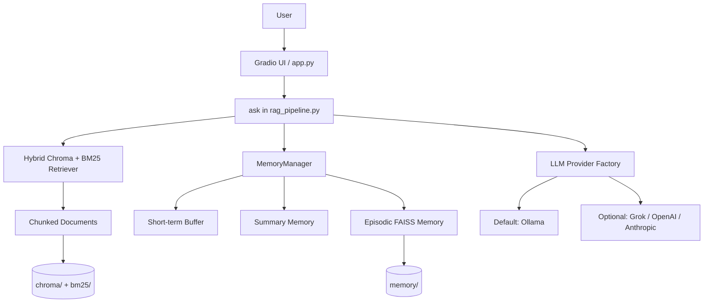

# DocForge RAG: Open-Source Document Research Assistant

An open, local-first RAG chatbot for asking questions over documents. The project combines multi-format document ingestion, hybrid Chroma and BM25 retrieval, conversational memory, and a pluggable LLM layer so it can be used as a learning project, a research prototype, or a starter template for a larger open-source assistant.

## What It Does

- Ingests Markdown, text, HTML, and PDF files from `data/` and builds synchronized Chroma and BM25 indexes.
- Retrieves dense and BM25 results, fuses ranks with configurable weighted RRF, then reranks the top 20 candidates to keep the top 5.
- Answers user questions through a retrieval-augmented generation pipeline.
- Preserves short-term chat context, summarized memory, and episodic memory.
- Defaults to Ollama for local inference, while keeping the LLM layer easy to swap.
- Exposes a simple Gradio UI for interactive conversations.

## Why This Project Exists

This repository was originally built as a focused academic project, but the codebase is structured so it can grow beyond that use case. The goal is to provide a clean, inspectable baseline for anyone who wants to study or extend a practical RAG system without being locked into a single model vendor or a report-only workflow.

The design is intentionally open-ended:

- The LLM provider is isolated behind a small factory in `llm_factory.py`.
- The ingestion, retrieval, memory, and UI layers are separated into independent modules.
- The code can be reused with local models, hosted APIs, or custom tools.
- The repository is small enough to understand, but realistic enough to serve as a foundation.

## Architecture



### Main Components

`document_loader.py`: Loads Markdown, text, HTML, and PDF inputs and persists raw and normalized documents.

`chunking.py`: Implements the fixed, structure-aware, and semantic splitters, near-duplicate filtering, chunk metadata, and BM25 corpus preparation.

`ingest.py`: Orchestrates document loading, chunking, embedding with Hugging Face `all-MiniLM-L6-v2`, and synchronized Chroma/BM25 index creation.

`rag_pipeline.py`: Builds the question-answering flow. It retrieves relevant chunks, injects memory, formats prompts, and calls the active LLM.

`memory_manager.py`: Maintains three memory layers: recent chat history, compressed summary memory, and long-term episodic retrieval.

`llm_factory.py`: Central place to choose the LLM backend. Ollama is the default, but commented examples are included for alternative providers.

`app.py`: Launches the Gradio chat interface.

## Strengths

- Local-first by default, which is better for privacy, offline work, and repeatable demos.
- Clear separation of concerns, which makes the code easier to extend.
- Multi-layer memory, which is stronger than a plain single-turn RAG prototype.
- Provider flexibility, so the same application can be adapted for Ollama or hosted APIs.
- Small enough to understand quickly, but complete enough to demonstrate a real end-to-end pipeline.

## Limitations

- Used HuggingFace embedding because OpenAI embeddings require an `OPENAI_API_KEY`; PDF extraction quality depends on `pdfplumber`.
- The default Ollama path requires a local model download and enough hardware to run it smoothly.
- There is no authentication, multi-user access control, or deployment hardening yet.
- Memory is session-oriented and simple by design, not a full production memory service.
- The current implementation does not include eval benchmarks, citations in the UI, or streaming token output.
- Hosted providers such as Grok or OpenAI require you to install their LangChain integration packages and provide your own API keys.

## Reproduce Locally

### 1. Clone the repository

```bash
git clone https://github.com/qasim233/docforge-rag
cd docforge-rag
```

### 2. Create and activate a virtual environment

On Windows PowerShell:

```powershell
python -m venv .venv
.\.venv\Scripts\Activate.ps1
```

### 3. Install dependencies

```bash
pip install -r requirements.txt
```

If you want to use a hosted provider instead of Ollama, also install the matching integration package:

```bash
pip install langchain-openai
# or
pip install langchain-anthropic
```

### 4. Add your documents

Place `.md`, `.markdown`, `.txt`, `.html`, `.htm`, or `.pdf` files you want to query inside `data/`.

Hybrid retrieval defaults to dense/sparse RRF weights of `0.7`/`0.3` and uses
`cross-encoder/ms-marco-MiniLM-L-6-v2` for reranking. Configure weights with
`DOCFORGE_DENSE_WEIGHT` and `DOCFORGE_SPARSE_WEIGHT`, or choose a different
cross-encoder with `DOCFORGE_RERANKER_MODEL`.

### 5. Build the retrieval indexes

```bash
python ingest.py
```

The command creates the Chroma database under `chroma/`, a persisted BM25
corpus under `bm25/`, and an index manifest that keeps both indexes paired.

### 6. Choose your LLM backend

The default configuration uses Ollama. Make sure it is running and the model is available:

```bash
ollama serve
ollama pull gemma2:9b
```

If you want Grok, OpenAI, or another API, edit `llm_factory.py` and uncomment the provider block you want to use.

### 7. Run the app

```bash
python app.py
```

Then open the local Gradio URL shown in the terminal, usually `http://localhost:7860`.

## Using It As an Open-Source Base

The code is intentionally arranged so other developers can treat it as a template rather than a finished report artifact.

- Swap the model provider by editing one small file.
- Replace the PDF domain with your own dataset.
- Add tool integrations inside `rag_pipeline.py`.
- Extend memory logic in `memory_manager.py`.
- Replace the UI with a web app, API server, or desktop client.

If you publish this publicly, consider adding:

- A permissive license such as MIT or Apache-2.0.
- An `.env.example` file for provider keys and local settings.
- A short demo video or screenshots.
- A contribution guide and issue templates.
- A small evaluation set so new contributors can test changes.

## Suggested Roadmap

- Add streaming responses in the UI.
- Add citations for every answer.
- Make the provider selection fully environment-driven.
- Add unit tests for ingestion, memory, and prompt construction.
- Add a lightweight API server so the UI can be swapped independently.
- Add provider adapters for more local and hosted models.

## Repository Layout

```text
Document_Research_Assistant/
├── app.py
├── chunking.py
├── document_loader.py
├── ingest.py
├── llm_factory.py
├── memory_manager.py
├── rag_pipeline.py
├── requirements.txt
├── data/
├── chroma/
├── bm25/
├── memory/
```

## Notes On Generated Files

The `memory/`, `chroma/`, `bm25/`, and `index_manifest.json` artifacts are generated at runtime. They can be recreated from source data, so they should normally stay out of version control.